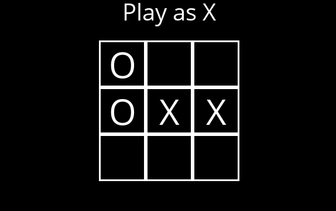
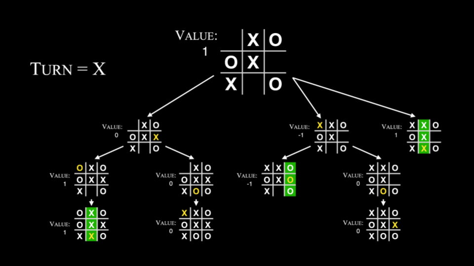

# Tic-Tac-Toe avec Minimax

Jeu de Tic-Tac-Toe sur une grille de 3 × 3, où un joueur humain affronte une IA. L'IA choisit ses coups avec l'algorithme **Minimax** et l'**élagage alpha-bêta** : elle explore les suites possibles de la partie et évite d'examiner certaines branches qui ne peuvent pas améliorer le résultat.

## Interface du runner



## Fonctionnalités

- Choix de jouer avec `X` ou `O`.
- Réponse automatique de l'IA après chaque coup du joueur.
- Détection de victoire, de défaite ou de match nul.
- Possibilité de recommencer une partie.

## Comment jouer

1. Lancez le jeu et choisissez **Play as X** ou **Play as O**.
2. Cliquez sur une case vide pour jouer votre symbole.
3. L'IA joue automatiquement avec l'autre symbole.
4. Quand la partie est terminée, cliquez sur **Play Again** pour recommencer.

`X` commence toujours la partie. Une ligne horizontale, verticale ou diagonale de trois symboles identiques remporte la partie. Si la grille est pleine sans alignement gagnant, la partie est nulle.

## Algorithme de l'IA

L'IA utilise **Minimax**, un algorithme de recherche adversariale. À partir de la grille courante, elle simule les suites de coups possibles jusqu'à la fin de la partie. Elle suppose que chaque joueur choisira toujours le coup qui lui est le plus favorable, puis sélectionne le meilleur coup contre cet adversaire optimal. Elle n'apprend pas de parties précédentes : elle refait cette recherche à chaque tour.

### États et coups

Une position est une grille de trois lignes contenant `X`, `O` ou `EMPTY`. Les coups légaux sont les cases vides, repérées par un couple `(ligne, colonne)` entre `0` et `2`. Pour explorer un coup, l'IA crée une copie de la grille et y place le symbole du joueur actif. La recherche se termine lorsqu'un joueur a aligné trois symboles ou que la grille est pleine.

### Valeur des positions

Les fins de partie reçoivent une valeur selon le résultat :

```text
U(s) =  1  si X a gagné
        0  si la partie est nulle
       -1  si O a gagné
```

À chaque tour, le joueur actif choisit la valeur qui lui est favorable. `X` maximise le score ; `O` le minimise. La valeur Minimax `V(s)` d'une position non finale se calcule ainsi :

```text
V(s) = U(s)                                      si la partie est terminée
V(s) = max_{a ∈ Actions(s)} V(Result(s, a))       si X joue
V(s) = min_{a ∈ Actions(s)} V(Result(s, a))       si O joue
```

Le calcul alterne ainsi entre des niveaux MAX et MIN : chaque joueur tient compte de la meilleure réponse possible de son adversaire.



*Illustration : image trouvée via cet [article Medium](https://medium.com/@mhhassaan.1/mini-max-algorithm-in-artificial-intelligence-e0a0da694b3b); elle est reproduite ici sans modification.*

À chaque nouvel appel de Minimax, la profondeur `d` commence à `20` depuis le plateau actuel. Chaque coup simulé la diminue de `1`. Quand une fin de partie est atteinte, `d` indique donc combien de niveaux de recherche restaient. Plus la victoire arrive tôt, plus `d` est grand :

```text
score =  1 + d   si X gagne
score = -1 - d   si O gagne
score =  0       si la partie est nulle
```

Par exemple, une victoire de `X` après deux coups simulés donne `d = 18` et un score de `19` ; après cinq coups, `d = 15` et le score est `16`. Comme `X` maximise le score, il préfère la victoire la plus rapide. `O`, qui minimise le score, préfère aussi gagner rapidement (un score plus négatif) et retarder une défaite inévitable. La valeur initiale `20` ne limite pas la recherche : une partie de Tic-Tac-Toe se termine en au plus neuf coups depuis un plateau vide, donc la recherche atteint toujours une fin de partie.

### Élagage alpha-bêta

L'**élagage alpha-bêta** accélère Minimax sans changer le coup optimal. `alpha` est le meilleur score déjà trouvé pour `X` et `beta` le meilleur pour `O`. Lors de la recherche :

```text
à un niveau MAX : alpha = max(alpha, score)
à un niveau MIN : beta  = min(beta, score)
si alpha >= beta : arrêter d'explorer cette branche
```

Le Tic-Tac-Toe est assez petit pour que la recherche atteigne une position finale : aucune fonction heuristique n'est nécessaire pour estimer une partie inachevée. Si les deux joueurs jouent parfaitement, la partie se termine par un match nul ; l'IA ne peut donc pas être battue par un adversaire parfait.

## Installation et lancement

```bash
git clone https://github.com/cestbryan-ng/Minimax.git
cd Minimax
python -m pip install -r requirements.txt
python runner.py
```

Le projet utilise Pygame. La police `OpenSans-Regular.ttf` doit rester à côté de `runner.py`, car l'interface la charge depuis ce dossier.
